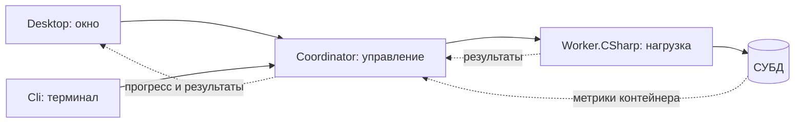

# Как устроен BenchForge

На верхнем уровне находится решение `BenchForge.slnx`. Оно объединяет шесть C#-проектов. Проект в Visual Studio — это узел с иконкой C#, внутри которого находятся исходники и файл настроек `.csproj`.

## Шесть проектов

| Проект | Назначение | Что получается после сборки |
| --- | --- | --- |
| BenchForge.Desktop | Окно Avalonia: выбор баз, параметры нагрузки, графики и таблицы | Запускаемое настольное приложение |
| BenchForge.Coordinator | Организация эксперимента: запуск временной базы и движка, сбор серверных метрик, сохранение отчётов | Библиотека, которую используют Desktop и Cli |
| BenchForge.Worker.CSharp | Нагрузочный движок: прямое подключение к СУБД, генерация и загрузка данных, запросы, измерения клиента | Отдельная запускаемая программа без окон |
| BenchForge.Contracts | Общие настройки, команды, результаты, генератор данных и формат гистограмм | Библиотека общих типов |
| BenchForge.Cli | Запуск тех же экспериментов из терминала без окна Avalonia | Консольное приложение |
| BenchForge.Tests | Автоматические проверки расчётов, протокола, отчётов и сквозных запусков | Тестовый проект |

`BenchForge` — имя продукта. Слова после точки обозначают роль проекта. `CSharp` в Worker указывает язык движка. Другие самостоятельные реализации находятся в `workers/java`, `workers/python`, `workers/rust`, `workers/node` и `workers/go`; их исходники открываются редакторами соответствующих языков. Они общаются с C#-координатором по одинаковому протоколу JSONL.

`WorkerCatalog.cs` выбирает программу запуска, `WorkerConformance.cs` проверяет одинаковые данные/гистограммы, `WorkerPreparation.cs` запускает сборку зависимостей, `EngineSettings.cs` содержит выбор языков в интерфейсе. [Подготовка движков](../workers/README.md).

## Как проходит запуск теста

1. Пользователь нажимает «Начать эксперимент» в Desktop.
2. Desktop собирает настройки и вызывает Coordinator.
3. Coordinator создаёт временный экземпляр СУБД, запускает отдельную программу Worker.CSharp и передаёт ей сценарий.
4. Worker создаёт/загружает данные, прогревает базу и выполняет запросы напрямую в СУБД. Интерфейс не пересылает каждый запрос.
5. Worker возвращает счётчики, распределения задержек и метрики своего процесса. Coordinator отдельно собирает метрики контейнера БД, проверяет сообщения и сохраняет JSON/CSV.
6. Desktop получает прогресс и результаты и обновляет графики.

SQLite выполняется внутри Worker, поэтому отдельного контейнера и отдельной серверной RAM у неё нет. Для остальных поддерживаемых СУБД Coordinator создаёт контейнер Docker.

Desktop и Worker — разные процессы. Интерфейс отвечает за отображение, Worker — за выдачу нагрузки. Общие CPU и память компьютера при этом всё ещё могут влиять на оба процесса. Coordinator и Contracts — библиотеки, а не ещё два обязательных фоновых процесса.

## Файлы Desktop, которые видны на скриншоте

- `Program.cs` — точка входа настольной программы; запускает Avalonia.
- `App.cs` — настраивает приложение, тему, стили и создаёт главное окно.
- `MainWindow.cs` — кнопки, поля настроек, вкладки, обработка действий пользователя, отображение результатов. В первом прототипе интерфейс написан прямо на C#.
- `ComparisonChart.cs` — рисует сравнительные столбчатые графики.
- `packages.lock.json` — фиксирует версии NuGet-зависимостей. Это служебный файл воспроизводимой сборки.

В Worker тоже есть `Program.cs`: это точка входа другой программы, которая читает команды и запускает движок. Одинаковые имена файлов допустимы в разных проектах. `BenchmarkEngine.cs` содержит выполнение тестов, а папка `Databases` — адаптеры конкретных СУБД.

В Coordinator файл `WorkerProcess.cs` отвечает за запуск дочерней программы и чтение её сообщений. Он не выполняет запросы в базу вместо Worker.

## Папки и файлы решения

- `src` — рабочие проекты приложения.
- `tests` — тестовый проект.
- `configs` — готовые JSON-настройки экспериментов.
- `docs` — описание протокола и структуры.
- `.csproj` — параметры конкретного проекта, зависимости и ссылки на другие проекты.
- `.slnx` — список проектов решения и их группировка в Visual Studio.
- `Directory.Build.props` / `Directory.Build.targets` — общие параметры и действия сборки.
- `bin` / `obj` — автоматически создаваемые файлы сборки, а не основной код приложения.

Чтобы запускалось окно, стартовым проектом в Visual Studio должен быть **BenchForge.Desktop**. Для измерений используйте конфигурацию Release.
